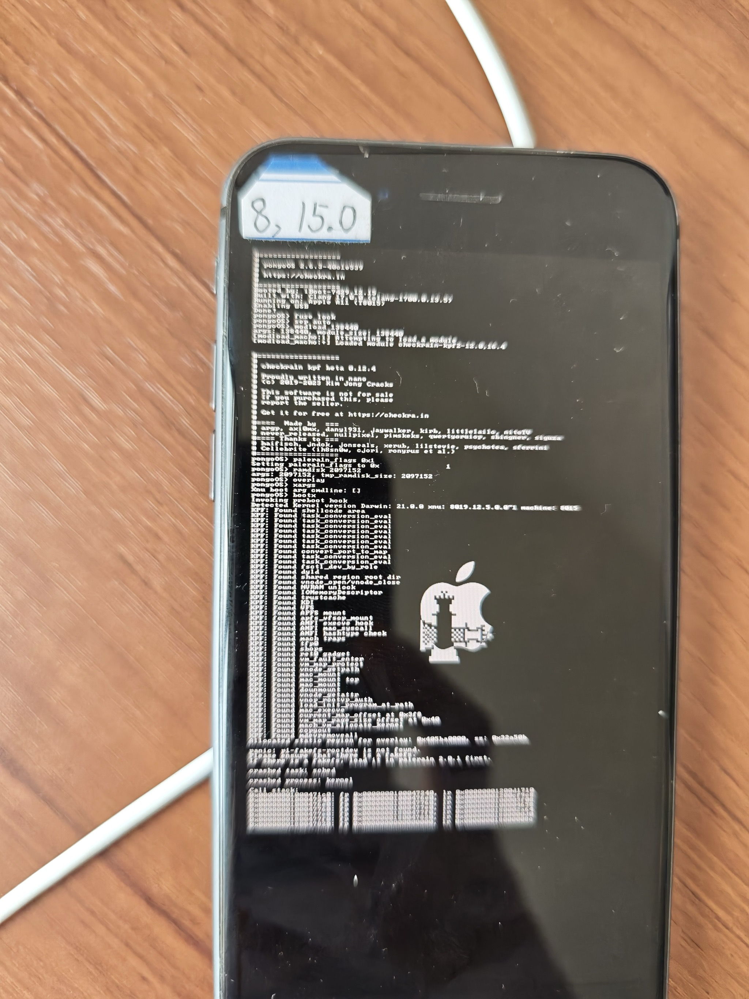
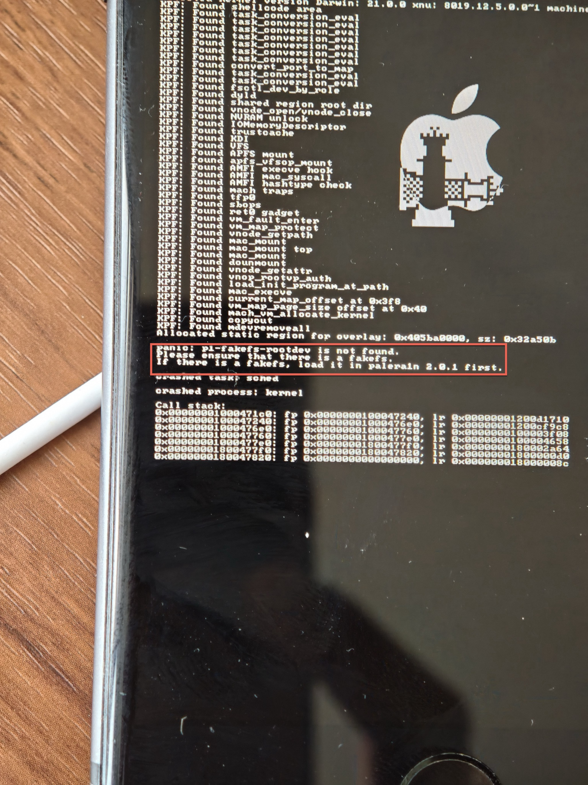
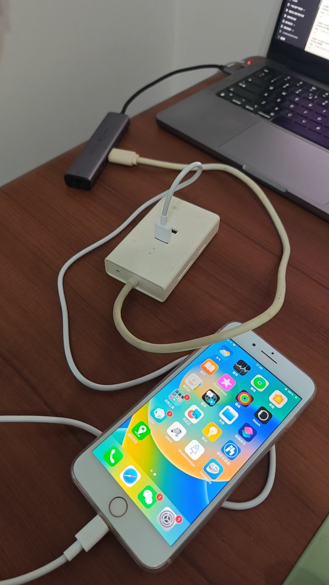
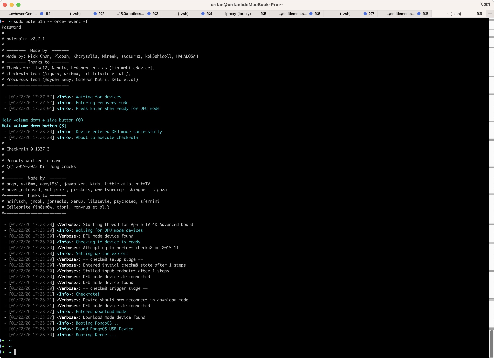

# panic: p1-fakefs-rootdev is not found

* 现象：用palera1n去（`palera1n -c -f`）新的越狱 或 （`palera1n -f`）恢复越狱，时，往往会遇到：虽然各个操作和步骤都对，但是最后还是无法正常实现palera1n的越狱=iPhone启动后没有palera1n的app，而此时往往越狱期间看到的，苹果手机的刷出的大量的logo中，有对应的报错：`panic: p1-fakefs-rootdev is not found`
  * 
  * 
* 原因
  * 情况1=原因1：此处本身没有fakefs，所以无法恢复越狱，是正常的
    * 细节：对于iOS 15.0的iPhone8，之前是用了Dopamine，去做了rootless的无根越狱，本身就没有fakefs，而自己误以为之前是用了palera1n的rootful的越狱，所以尝试用`palera1n -f`去恢复越狱，所以始终失败，而报此错误
    * 解决办法：只能继续去想办法去重新用palera1n去rootful越狱，或者用旧的已有的Dopamine的rootless越狱，都可以
  * 情况2=原因2：palera1n全新越狱失败，前面的`palera1n -c -f`创建fakefs失败，导致后续`palera1n -f`启动时，找不到fakefs，无法越狱
    * 细节：对于此处的iOS 15.0的iPhone8，已经打算用`palera1n -c -f`去全新越狱，但是试了多次，还是此错误，找不到fakefs
    * 解决办法：
      * （之前试过，此处暂时还没试，但是应该有效）尝试用`sudo palera1n --force-revert -f`去清除之前残留的异常的内容（fakefs），然后再重新`palera1n -c -f`+`palera1n -f`，应该就可以了
        * 补充说明：之前以为会有个缺点，之前安装的app都丢失了呢，但是其实不是，早些时候试过这个办法，是：之前本身异常的残留的Sileo，此处经过revert后，而丢失了，但其他正常的普通的app，包括Shadowrocket、TrollStore等等，全都在的，是不会丢失普通正常的app的
    * 效果
      * 之前试过的效果：
        * 设备连接方式：
          * 
        * Mac中的终端的日志：
          * 

```bash
➜  ~ sudo palera1n --force-revert -f
Password:
#
# palera1n: v2.2.1
#
# ========  Made by  =======
# Made by: Nick Chan, Ploosh, Khcrysalis, Mineek, staturnz, kok3shidoll, HAHALOSAH
# ======== Thanks to =======
# Thanks to: llsc12, Nebula, Lrdsnow, nikias (libimobiledevice),
# checkra1n team (Siguza, axi0mx, littlelailo et al.),
# Procursus Team (Hayden Seay, Cameron Katri, Keto et.al)
# ==========================
 
 - [01/22/26 17:27:52] <Info>: Waiting for devices
 - [01/22/26 17:27:52] <Info>: Entering recovery mode
 - [01/22/26 17:28:04] <Info>: Press Enter when ready for DFU mode
 
Hold volume down + side button (0)
Hold volume down button (3)
 - [01/22/26 17:28:20] <Info>: Device entered DFU mode successfully
 - [01/22/26 17:28:20] <Info>: About to execute checkra1n
#
# Checkra1n 0.1337.3
#
# Proudly written in nano
# (c) 2019-2023 Kim Jong Cracks
#
#========  Made by  =======
# argp, axi0mx, danyl931, jaywalker, kirb, littlelailo, nitoTV
# never_released, nullpixel, pimskeks, qwertyoruiop, sbingner, siguza
#======== Thanks to =======
# haifisch, jndok, jonseals, xerub, lilstevie, psychotea, sferrini
# Cellebrite (ih8sn0w, cjori, ronyrus et al.)
#==========================
 
 - [01/22/26 17:28:20] <Verbose>: Starting thread for Apple TV 4K Advanced board
 - [01/22/26 17:28:20] <Info>: Waiting for DFU mode devices
 - [01/22/26 17:28:20] <Verbose>: DFU mode device found
 - [01/22/26 17:28:20] <Info>: Checking if device is ready
 - [01/22/26 17:28:20] <Verbose>: Attempting to perform checkm8 on 8015 11
 - [01/22/26 17:28:20] <Info>: Setting up the exploit
 - [01/22/26 17:28:20] <Verbose>: == checkm8 setup stage ==
 - [01/22/26 17:28:20] <Verbose>: Entered initial checkm8 state after 1 steps
 - [01/22/26 17:28:20] <Verbose>: Stalled input endpoint after 1 steps
 - [01/22/26 17:28:20] <Verbose>: DFU mode device disconnected
 - [01/22/26 17:28:20] <Verbose>: DFU mode device found
 - [01/22/26 17:28:20] <Verbose>: == checkm8 trigger stage ==
 - [01/22/26 17:28:21] <Info>: Checkmate!
 - [01/22/26 17:28:21] <Verbose>: Device should now reconnect in download mode
 - [01/22/26 17:28:21] <Verbose>: DFU mode device disconnected
 - [01/22/26 17:28:27] <Info>: Entered download mode
 - [01/22/26 17:28:27] <Verbose>: Download mode device found
 - [01/22/26 17:28:27] <Info>: Booting PongoOS...
 - [01/22/26 17:28:29] <Info>: Found PongoOS USB Device
 - [01/22/26 17:28:30] <Info>: Booting Kernel...
```
