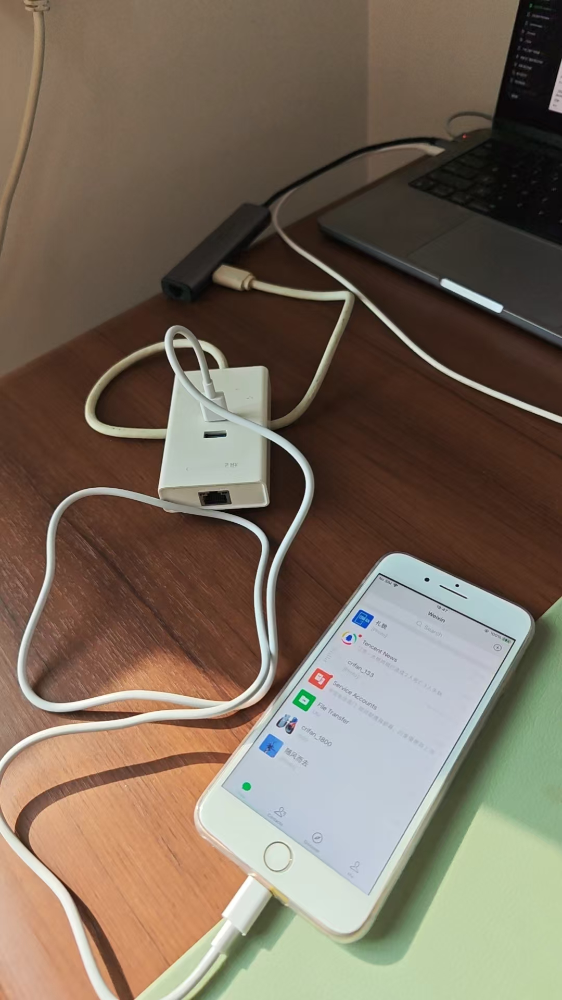
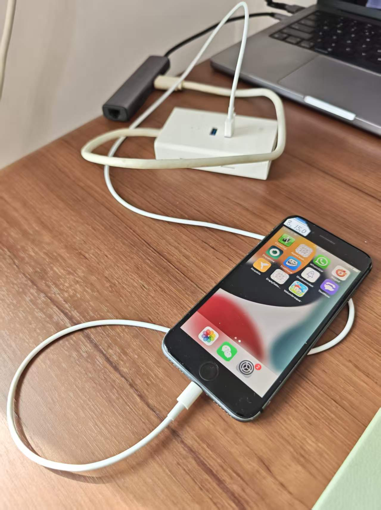
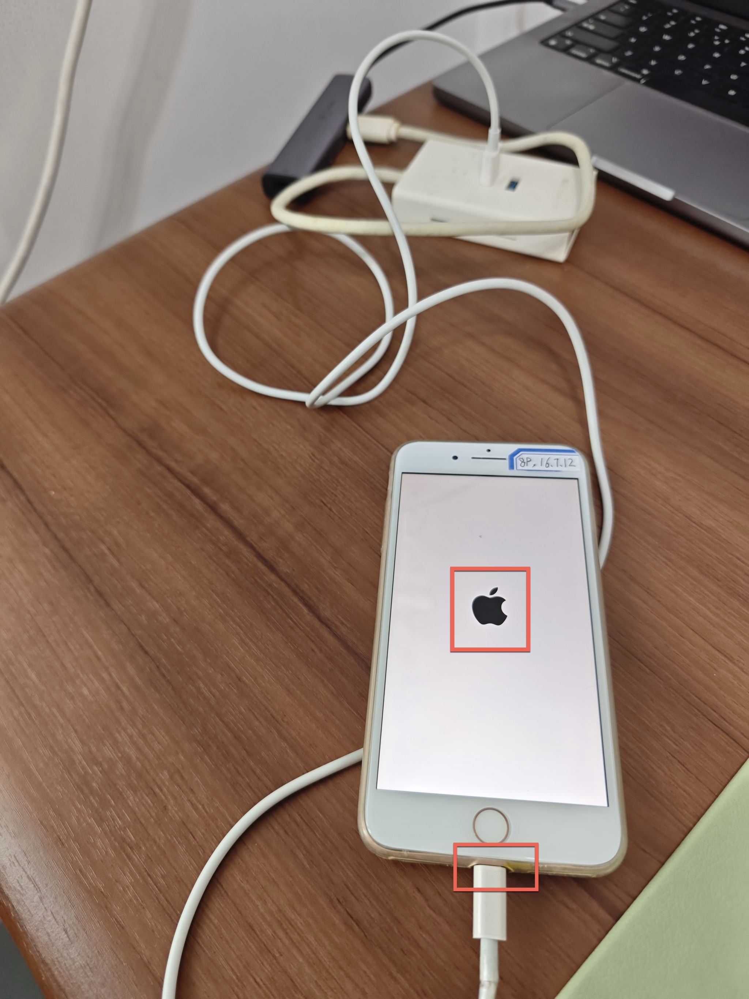
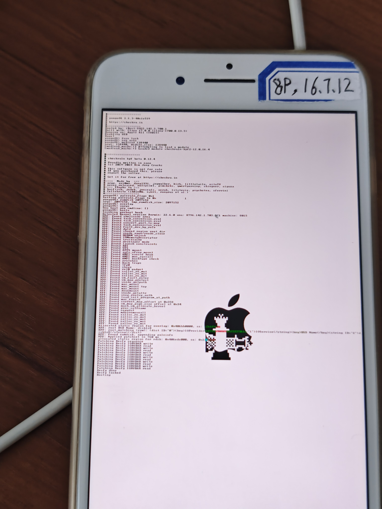

# USB-C无法识别

对于早期的Mac电脑，是自带`USB-A`=`USB Type-A`=`大口USB接口`的，此时，都可以正常使用palera1n去越狱。

而对于新的Mac，往往没有USB-C接口，只有`USB-C`=`USB Type-C`接口=`小口USB接口`，而对于这类USB-C接口：

[官网](https://github.com/palera1n/palera1n?tab=readme-ov-file#device-support)也已经说了：

* 会有问题=无法正常进入DFU模式=`USB-A cables are recommended to use, USB-C to may have issues with palera1n and getting into DFU mode.`
* 解决办法是：换用USB-A接口，且确保：当DFU断开连接时，及时重新拔插，确保能找到DFU设备，才能继续

## 硬件上：物理连接方式：`USB-C转换器` + `USB-A集线器` + `USB数据线` + `iPhone`

* 具体步骤是：
  * 先接一个**USB-C**口的：`USB转接口`=`USB转换器`=`USB转换头`：输入是USB-C接口，输出是多个USB-A接口（可选：还有其他额外功能接口）
  * 在USB-C口的USB转换器后面，再接入正常的，**USB-A**口的，相对老旧一点的`USB-A集线器`=单个USB-A接口作为输入，去转换出多个USB-A接口的集线器
  * 在老旧的USB-A口的USB转换器中，连上USB数据线（USB-A口转Lighting），接上最终的iPhone手机
* 效果
  * 举例1：`iPhone 8 Plus， iOS 16.7.12`
    * 
  * 举例2：`iPhone 8，iOS 15.0`
    * 

## 软件上：使用期间要及时拔插以确保能及时找到DFU设备，才能继续

即使物理上硬件上已连接好了，越狱操作期间，在软件使用上，也要注意：

对于典型的：

* 用`palera1n -c -f`去开始新的越狱
* 或用`palera1n -f`去恢复越狱

时，在出现了`DFU mode device disconnected`后，往往会就：永远卡死，此时属于：

* 遇到了问题：找不到（iPhone）设备了
* 解决办法：在合适时机，快速拔插USB数据线
* 具体步骤：
  * 在 **DFU mode device disconnected** 之后，在iPhone手机屏幕上，此时往往开始是黑屏或白屏=还没内容，等大概2秒左右，会出现：苹果Apple的logo
    * 补充说明：如果还没出现苹果Logo就去快速拔插USB数据线，好像：往往就无效，无法让后续找到DFU的iPhone设备，就无法继续越狱
    * 效果：
      * 
  * 然后再去：**快速拔插USB数据线**
    * 具体拔插的对象：对于USB-A转Lighting的，连接到iPhone端的Lighting数据线的那一端，即iPhone端的数据线
    * 动作：快速（大概半秒以内）拔掉后再重新插上
  * 然后正常的话，顺利的话，才会继续出现：`Download mode device found`=表示找到DFU的iPhone设备了
    * 之后才会正常出现：`Booting PongoOS...` + `Found PongoOS USB Device` + `Booting Kernel...`，才是正常启动（PongoOS）系统，继续（恢复）越狱
* 效果
  * Mac的终端中显示的日志：

```bash
➜  ~ palera1n -f
#
# palera1n: v2.2.1
#
# ========  Made by  =======
# Made by: Nick Chan, Ploosh, Khcrysalis, Mineek, staturnz, kok3shidoll, HAHALOSAH
# ======== Thanks to =======
# Thanks to: llsc12, Nebula, Lrdsnow, nikias (libimobiledevice),
# checkra1n team (Siguza, axi0mx, littlelailo et al.),
# Procursus Team (Hayden Seay, Cameron Katri, Keto et.al)
# ==========================
 
 - [10/13/26 15:42:12] <Info>: Waiting for devices
 - [10/13/26 15:42:12] <Info>: Entering recovery mode
 - [10/13/26 15:42:23] <Info>: Press Enter when ready for DFU mode
 
Hold volume down + side button (0)
Hold volume down button (3)
 - [10/13/26 15:42:38] <Info>: Device entered DFU mode successfully
 - [10/13/26 15:42:39] <Info>: About to execute checkra1n
#
# Checkra1n 0.1337.3
#
# Proudly written in nano
# (c) 2019-2023 Kim Jong Cracks
#
#========  Made by  =======
# argp, axi0mx, danyl931, jaywalker, kirb, littlelailo, nitoTV
# never_released, nullpixel, pimskeks, qwertyoruiop, sbingner, siguza
#======== Thanks to =======
# haifisch, jndok, jonseals, xerub, lilstevie, psychotea, sferrini
# Cellebrite (ih8sn0w, cjori, ronyrus et al.)
#==========================
 
 - [10/13/26 15:42:39] <Verbose>: Starting thread for Apple TV 4K Advanced board
 - [10/13/26 15:42:39] <Info>: Waiting for DFU mode devices
 - [10/13/26 15:42:39] <Verbose>: DFU mode device found
 - [10/13/26 15:42:39] <Info>: Checking if device is ready
 - [10/13/26 15:42:39] <Verbose>: Attempting to perform checkm8 on 8015 11
 - [10/13/26 15:42:39] <Info>: Setting up the exploit
 - [10/13/26 15:42:39] <Verbose>: == checkm8 setup stage ==
 - [10/13/26 15:42:39] <Verbose>: Entered initial checkm8 state after 1 steps
 - [10/13/26 15:42:39] <Verbose>: Stalled input endpoint after 1 steps
 - [10/13/26 15:42:39] <Verbose>: DFU mode device disconnected
 - [10/13/26 15:42:39] <Verbose>: DFU mode device found
 - [10/13/26 15:42:39] <Verbose>: == checkm8 trigger stage ==
 - [10/13/26 15:42:39] <Info>: Checkmate!
 - [10/13/26 15:42:39] <Verbose>: Device should now reconnect in download mode
 - [10/13/26 15:42:40] <Verbose>: DFU mode device disconnected
 - [10/13/26 15:42:46] <Info>: Entered download mode
 - [10/13/26 15:42:46] <Verbose>: Download mode device found
 - [10/13/26 15:42:46] <Info>: Booting PongoOS...
 - [10/13/26 15:42:48] <Info>: Found PongoOS USB Device
 - [10/13/26 15:42:48] <Info>: Booting Kernel...
```
  * iPhone中：正在启动PongoOS系统
    * 

* 其他细节
  * 如果出现了：`<Error>: Timed out waiting for download mode (error code: -status_exploit_timeout_error)`则表示始终没找到DFU的iPhone设备而报错，则：可以重新多试几次，一般都可以顺利找到DFU的iPhone设备，可以继续越狱
